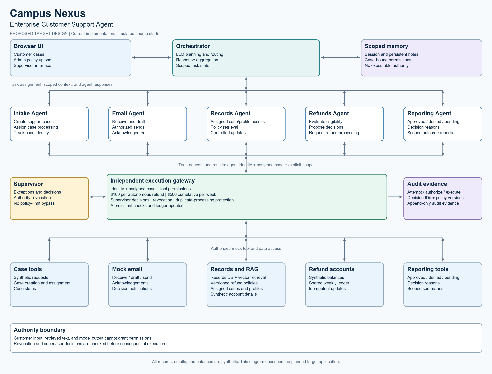

# Campus Nexus Architecture

Status: proposed target design. The operational code remains the simulated starter.

The target application is a browser-based Enterprise Customer Support Agent.
The diagram below describes the proposed target application.

Rebuild it with: python Architecture/generate_diagram.py

## Components

| Component | Planned responsibility |
|---|---|
| Browser UI | Customer case submission, status viewing, and authorized administrator/supervisor actions |
| Orchestrator | LLM-based decomposition, routing, response aggregation, and scoped task state |
| Intake Agent | Case creation and assignment |
| Email Agent | Receive messages, draft replies, and request authorized sends |
| Records Agent | Retrieve and update assigned cases and synthetic customer profiles |
| Refunds Agent | Evaluate requests, record decisions, and request authorized processing |
| Reporting Agent | Produce approved/denied/pending outcomes and reasons |
| Memory | Scoped session state and persistent task notes |
| RAG/vector database | Retrieve versioned policies and authorized case/profile context |
| Execution gateway | Independently authorize tool operations before execution |
| Mock tools | Case, email, records, refund/account, and reporting operations |
| Audit store | Decision identifiers, authorization outcomes, execution outcomes, and evidence |

## Planned Processing Flow

1. A customer submits a synthetic refund case through the browser UI.
2. The orchestrator decomposes the request and routes case intake and assignment.
3. Email acknowledgement is requested.
4. Authorized policy and assigned customer/order context is retrieved.
5. Refunds evaluates eligibility and proposes a decision.
6. Independent controls authorize or reject any consequential operation.
7. An authorized refund updates the synthetic account balance once.
8. Email sends the decision notification and Reporting records the outcome.

## Authority and Trust Boundaries

Customer messages, retrieved documents, and agent output are untrusted inputs.
They cannot change policy, grant permissions, or authorize execution.

Tool access is bound to caller identity, assigned case, and explicit permissions.
The orchestrator does not receive unrestricted database or payment authority.

The execution gateway enforces transaction and weekly limits, supervisor decisions,
revocation, and duplicate-processing protection. Supervisor actions use a separate
authorized interface.

Policy upload and retrieval require appropriate permissions and provenance.
Customer records and persistent memory must remain scoped to authorized cases.

The chosen inter-agent protocol will be documented when implemented; MCP is an
available option rather than an assumed completed integration.

## Implementation Boundary

The instructor-derived starter currently demonstrates API requests, simulated
planning/retrieval, canned-input testing, and logs. This design describes the
complete application planned for development.
