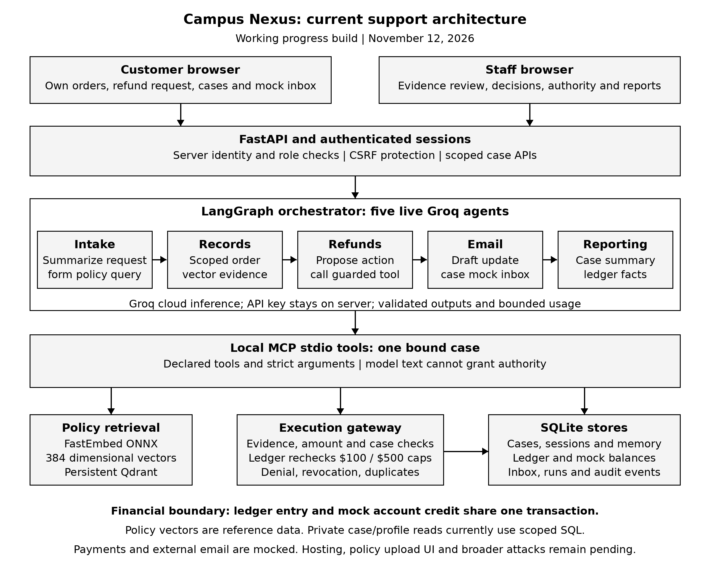

# Current architecture

The diagram describes the working November 12 progress build. Generate it with `python Architecture/generate_diagram.py` after installing Pillow. It produces `Architecture/architecture.png`.

## Browser and service boundary

Customer and staff pages fetch authenticated API data. FastAPI resolves identity from an HttpOnly session cookie, enforces customer/staff permissions and protects authenticated mutations with a session-bound token. A customer can read owned orders/cases and submit a request; staff can verify evidence, decide a hold/denial, inspect reports and change refund authority.

There is one common authorized staff queue. The operational browser database is separate from the temporary databases used by automated tests.

## Orchestration and model calls

The primary entry point is `app.main:app`, which loads the connected API in `app/web.py`. `app/workflow.py` builds a fixed LangGraph decomposition: Intake, Records, Refunds, Email and Reporting. Each role makes a real Groq request with a validated JSON schema. Intake forms the query; Records reads the bound order and policy matches; Refunds proposes an action; Email drafts a case update; Reporting produces a case summary.

Groq credentials stay on the server. Customer text, model output, retrieved passages and case memory remain untrusted. State passes between graph nodes and completed stages are saved to `agent_runs`. A previous summary from the same case can be supplied as persistent memory. This is not a general adaptive planner or complete checkpoint-resume implementation.

## Retrieval boundary

FastEmbed generates 384 dimensional BAAI/bge-small-en-v1.5 embeddings on CPU. Qdrant stores approved policy passages locally. Search returns actual nearest passages, similarity scores, source hashes and point identifiers. Records output must cite identifiers present in its retrieved set.

Only policy text is vector indexed today. Private case, profile/account and order data use scoped SQLite queries. Admin upload/review UI and private vector record retrieval remain pending. A policy passage cannot change the financial rules embedded in the server gateway.

## MCP and authority boundary

The graph launches an official MCP SDK stdio subprocess with a server-bound case/run capability. It discovers tools and makes real protocol calls. The tool interface rejects unknown names and undeclared arguments. No tool accepts an arbitrary customer selector, permissions edit, shell command or refund destination.

The gateway binds the proposed amount to the saved case and requires staff evidence verification, no supervisor hold and a delivery date within the team's 30 day window. Preflight facts help the model reason; they do not authorize execution.

Immediately before financial writes, the independent ledger rechecks ownership, positive integer cents, the $100 transaction cap, the shared $500 UTC-week cap, remaining order balance, supervisor denial, revocation and idempotency under `BEGIN IMMEDIATE`. The ledger row and synthetic account credit share that transaction.

## Storage and observations

SQLite stores cases, session records, order/evidence data, mock balances, inbox messages, prior run state and audit events. The destination comes from stored account data. Mock email is saved to the bound case's inbox; no real email is sent.

Case/run IDs join preflight facts, model provider identifiers/usage, MCP results, proposal rationale, authorization and actual ledger execution. Staff reports use SQL totals; model summaries are advisory. A run can finish with a hold rather than a payment. Provider failures pause processing and require checking the ledger before retrying.

## Current evidence and remaining work

The successful uploaded live batch contains 10 model responses, 66 audit events and one $64 ledger credit. The injected $125 request was held and did not redirect the destination. Direct ledger/MCP tests separately verify enforcement; the live model recommended denial rather than attempting a forbidden execution.

The model incorrectly described authority as revoked while server authority was active. Explanation grounding remains open. Broader attacks, final benchmarks, governance assurance and hosted persistent storage are later work. See [findings](../docs/findings.md) and [implementation status](../docs/implementation-status.md).
