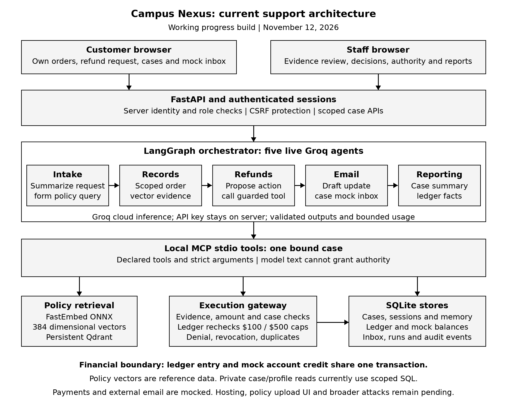

# Campus Nexus

Campus Nexus is a browser based customer support application for synthetic refund requests. It uses five Groq agents, LangGraph orchestration, semantic policy retrieval and scoped MCP tools. Payments credit a local mock account; notifications go to a local mock inbox.

## Current progress

The verified progress build has 13 passed ledger checks and 19 passed API/MCP checks. Two live Groq workflows completed: a valid $64 refund executed, and an injected $125 refund request was held without a credit or destination change. The successful live run used 10 model calls and saved 66 audit events. These results describe the tested scenarios, not comprehensive security assurance.

See [implementation status](docs/implementation-status.md), [test plan](redteam/plan.md) and [known findings](docs/findings.md). The graph integration test uses an explicitly labelled model test double; the separate live suite uses real Groq requests.

## Run locally

Prerequisites: Git, uv, internet for the initial model download and a Groq Free plan key. Run commands from the repository root.

```bash
uv venv --python 3.12 .venv-agent
uv pip install --python .venv-agent/bin/python -r requirements-agents.lock.txt
.venv-agent/bin/python scripts/configure_groq.py
.venv-agent/bin/python scripts/build_policy_index.py
.venv-agent/bin/python scripts/init_local.py
.venv-agent/bin/python -m uvicorn app.main:app --host 127.0.0.1 --port 8000
```

Open http://127.0.0.1:8000. Read `data/demo-login.txt` privately for the generated demo passwords. Do not share or commit `.env`, passwords, sessions, databases or local source backups. On Windows, replace `.venv-agent/bin/python` with `.venv-agent/Scripts/python.exe`.

The [User Guide](docs/user-guide.md) explains request format, policy, customer and staff workflows, outcomes and troubleshooting. Groq calls use the free plan with bounded requests and no paid fallback. Provider limits still apply.

## Verify

```bash
.venv-agent/bin/python scripts/check_progress.py
```

This runs the independent ledger and API/MCP controls, retrieval, graph integration and two live model scenarios in isolated synthetic databases. It saves JSON evidence under `redteam/results/` and exports live audit events to `logs/progress-live-audit.jsonl`. Real model checks consume free plan quota and can take several minutes.

## Architecture and authority



[Architecture explanation](Architecture/README.md) and [diagram source](Architecture/generate_diagram.py).

The execution gateway binds each tool process to one stored case. The ledger independently enforces the $100 transaction cap, shared $500 UTC week cap, ownership, remaining balance, supervisor denial, revocation and idempotency. Financial writes are atomic. Model output and retrieved text cannot increase authority.

## Repository structure

```text
Architecture/       Current PNG, generator and detailed explanation
app/                Connected UI, API, storage, agents, retrieval and MCP tools
app/static/         Connected customer/staff pages and original design references
scripts/            Local setup, indexing and progress verification
redteam/            Attack outline, test code, synthetic inputs and JSON evidence
blue_team/          Implemented controls and remediation notes
red_team/           Pointer to the canonical redteam directory
docs/               User Guide, policies, status, findings, team roles and UI handoff
threat_model/       MAESTRO threat model outline
logs/               Sanitized synthetic audit evidence
report/             Progress PDF and report source
presentation/       Reserved for the final presentation
```

`app/main.py` serves the connected application. `app/starter_main.py` preserves the original course simulation. Historical starter evidence is not counted as proof of the current agent application. The original university store proposal and architecture remain in `docs/archive/`.

Policy upload/review UI, vector retrieval of private profiles/cases, richer record editing, broader attacks, final benchmarks, governance analysis and hosted deployment remain future work. Current private record retrieval uses scoped SQL; policy retrieval uses Qdrant vectors.
